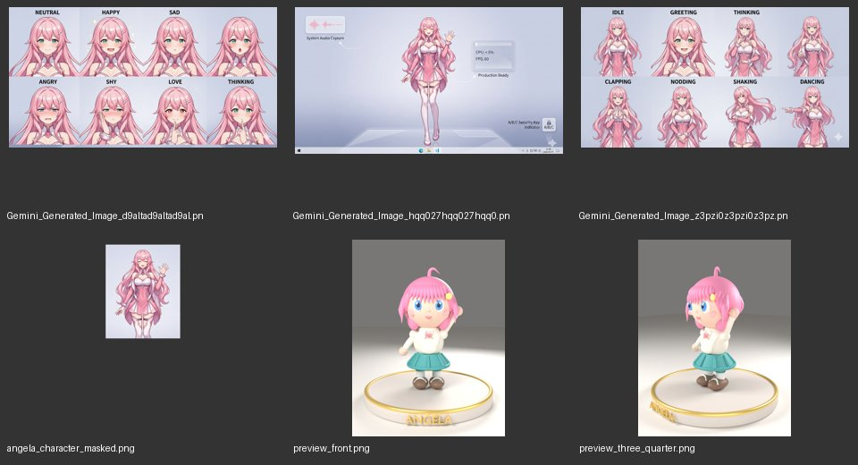

# Art Assets and Persona Audit

**Status:** asset inventory and disposition. No artwork was generated, replaced, or rebranded in this audit. Canonical identity is defined in `docs/superpowers/specs/2026-11-09-angela-character-system-design.md` (`angela.core@1.0.0`; Lucifaella is `angela.lucifaella@1.0.0`).

## Executive summary

The repository does not have "no art"; it has several disconnected art sets and incomplete asset provenance. The newly approved core design is independent of these assets; none is presumed to conform merely because its filename or metadata says Angela. There are two Live2D model packages, an existing Gemini-generated static pink-haired character illustration, three generated reference/composite sheets, and a clay model generated by another AI from project character material but rejected as the design baseline. The main issue is not raw absence but that no single visual canon is declared, asset identities are obscure, duplicated files proliferate, and some imagery is a composition/sprite sheet rather than a clean production-ready character asset.

Character identity/persona is also mixed: the current backend has a substantive Lucifaella host persona and a real per-user naming/handover flow; a legacy Miko personality JSON is still present but is not referenced by the backend source search and is not a reliable Angela art/persona brief. Several older docs describe deleted PersonalityManager behavior and must not be treated as current configuration.

## Scope and counting method

- Reviewed desktop Electron and Web Live2D Viewer art/resource/model files, Angela clay-model outputs, desktop character metadata, the shared standing-image config, current persona/identity source and relevant documentation.
- Exact counts below cover the matched asset extensions under the named directories only; they are inventory counts, not quality scores. Bundled Cubism SDK sample characters and unrelated game/app assets are not counted as Angela production art.
- Verified raster pixel dimensions, alpha bounds, file sizes and byte-identical duplicates for the listed resource/image folders. Opened a contact sheet of the representative generated images, static art and clay renders.

## Asset inventory

| Location / set | Count and format | Assessment | Recommended disposition |
| --- | --- | --- | --- |
| `apps/desktop-app/electron_app/resources/angela_character_masked.png` | 1 PNG, 1408×768 RGBA, 339 KB; character alpha bounds approx. x=501–906, y=18–520 | **Existing candidate static standee**, visually pink-haired, pink/white outfit on transparent background; not rigged. The metadata bbox (391×491 at x=508,y=26) differs from alpha bounds, so hit zones need validation. `source_image` is blank. | User confirms Gemini generation. Keep as exploratory/unverified candidate; check Gemini/service terms for intended use and redistribution. Do not bundle or treat as canonical until terms and identity match are recorded. |
| `Gemini_Generated_Image_hqq027hqq027hqq0.png` | 1 PNG, 1408×768 RGBA, 1.54 MB | **Not clean character art:** a full desktop/computer screenshot-style composition with character and UI elements. Poor as a transparent desktop avatar or clean promo illustration. | Retain only as an existing concept/composite reference; replace if it is used as a real product-facing hero image. |
| `Gemini_Generated_Image_d9altad9altad9al.png` | 1 PNG, 1408×736 RGBA, 2.08 MB | **Usable expression reference/sprite sheet**: 2×4 labeled facial-expression grid. Not a single expression and contains labels/layout in the art. Current shared config treats it as an expression sprite sheet. | Keep as an expression reference only after checking crop boundaries and consistent character identity; generate clean individual expression files only if runtime actually needs separate transparent layers. |
| `Gemini_Generated_Image_z3pzi0z3pzi0z3pz.png` | 1 PNG, 1408×736 RGBA, 1.98 MB | **Usable pose reference/sprite sheet**: 2×4 labeled pose grid, but some tiles repeat / naming is not fully consistent. Current config treats it as a pose sheet. | Keep for reference; audit each tile and remove labels/repeated poses only if the sheet is used in runtime. |
| `apps/desktop-app/electron_app/models/Epsilon_free/runtime/` | 1 `.moc3`, model/physics/ID JSON, texture, 8 expressions, 15 motions (28 filesystem entries incl. files/directories as globbed) | **Substantive third-party Live2D package**, downloaded from the official website per user; currently default in config. Visual identity is not evidently the approved pink-haired canon. License/redistribution terms have not been verified. | Technical candidate only; character ID intentionally unset. Source is the Live2D official website per user; exact model page/version are not yet recorded. Do not redistribute/package until exact model-specific terms permit it. Verify appearance and runtime separately. |
| `apps/desktop-app/electron_app/models/miara_pro_en/runtime/` | 1 `.moc3`, model/physics/ID JSON, 3 scene motions, texture | **Substantive second third-party Live2D model**, downloaded from the official website per user; configured as fallback. Its character identity and exact terms are unverified. | Technical candidate only; character ID intentionally unset. Source is the Live2D official website per user; exact model page/version are not yet recorded. Do not redistribute/package until model-specific terms are verified. |
| `models/angela_clay/` | `.blend` + `.glb` and 4 renders (front / 3⁄4 / side / back, 700×900) | **AI-generated clay exploration** based on project character material. User rejects its generic fitted-on design and lumpy details; it is not the selected style. | Rejected as visual baseline. Retain only as historical exploration; do not use its geometry/material/style as production reference. |
| `apps/desktop-app/electron_app/assets/icon.svg` and `icon.png` | SVG 256×256; PNG 32×32, 225 bytes | **Existing brand/icon assets**, pink face SVG is recognizable; 32px PNG is tiny for general app branding/high-DPI use. Its exact tray usage and platform adaptation are an implementation concern from the prior desktop audit. | Keep SVG as the larger source candidate; use platform-appropriate exports if later packaging work requires them. |
| Web viewer resource copies | 12 matched art/model assets; 3 source PNGs duplicate desktop byte-for-byte; expression/pose aliases are also byte-identical | **Redundant copies/aliases**, not extra unique art. Desktop and web viewer static files drift risk; file names such as `Gemini_Generated_Image_*` do not communicate actual roles. | Inventory/report only for now. Later centralize only through a deliberate asset pipeline, not a blind cleanup. |

### Representative visual sheet

The contact sheet is a review aid generated from existing local images; it is not product artwork.

### Counts

Exact extension counts from the reviewed roots:

- Electron app: **10 matched files** — 7 PNG, 1 SVG, 2 `.moc3` (the model JSON/texture/expression/motion items are not counted in the script's suffix-only summary unless their suffix matched exactly).
- Web Live2D Viewer: **12 matched files** — 9 PNG, 1 SVG, 2 `.moc3`.
- Angela clay set: **6 matched files** — 1 `.blend`, 1 `.glb`, 4 PNG.
- Four raster artwork resources in Electron resources total about **6.15 MB**; of these, the usable transparent standee is about **0.34 MB** and the three composite sheets are about **5.60 MB**.
- Byte-identical duplication was found for the desktop/web icon, character standee, the three generated source sheets, and both Live2D texture PNGs. `pose_sequence_1.png` is byte-identical to the generated pose sheet; `expression_pack_1.png` is byte-identical to the expression sheet.

## Character identity and personality sources

| Source | What it says / status | Classification |
| --- | --- | --- |
| `apps/backend/src/core/persona/lucifaella.py` | Current code-backed host character: 露茜法埃拉 / Lucifaella, Angel Workshop receptionist/showcase host (迎賓主持／看板娘); tone is professionally candid, sharp without cruelty, explicit about limitations. Has `host` and `handover` states; prompt builder injects it, and naming a personal Angela hands over the primary role. | **Canonical runtime persona source**, with host/handover and non-verbatim optional style guidance. The old 12% stake, twelve-agents, and Gemini-base-model claims have been removed from prompt identity; the coercive “no right to refuse” quote is non-canonical and removed from the active prompt. |
| `apps/backend/src/core/system/config/identity.py` + `apps/backend/configs/system/core.default.yaml` | Default name is Angela; a validated per-user override is stored separately; no universal rename. This is functional identity/name plumbing, not a full character biography or visual specification. | **Usable identity mechanics; visual/personality data absent.** |
| `docs/03-technical-architecture/identity-and-workshop-persona.md` | Documents current host/hand-over structure and factuality rules. It explicitly distinguishes the product brand (“Angela AI”) from a user-named AI instance. | **Usable as current design documentation**, cross-check against source when editing. |
| `apps/backend/configs/personality_profiles/miko_base.json` | Generic Miko assistant profile; generic opening line and values, with several numeric traits (`empathetic`, `creative`, `assertive`, `cautious`) set to 0. Backend source search found no loader/use for this file; current `PersonalityAdapter` expects a PersonalityManager that it warns may be unset. | **Legacy/placeholder-like and not established as active Angela persona.** Do not use as the authoritative character sheet or generate art from it. |
| `docs/09-archive/.../personality-manager.md` and older architecture docs | Describe a previous PersonalityManager/profile-loading architecture. The specific old code path is archived/deleted; current references indicate card integration is optional and Manager can be absent. | **Historical documentation, not proof of runtime behavior.** |
| `packages/shared-js/js/angela-character-config.js` (source) → `apps/desktop-app/electron_app/libs/shared-js/angela-character-config.js` (generated vendored copy) | Static-image body/touch mapping plus core/edition metadata and palette tokens. The vendored file is git-ignored and regenerated by `scripts/sync_shared_js.py`; the independent resource JSON provides asset provenance. The source image remains blank; coordinate model and parameter/expression IDs have not been compared against the source image/runtime model. | **Active identity palette metadata; visual model remains unverified.** The canonical palette is now in the runtime source path and the generated desktop copy is refreshed by the sync script; this does not recolor third-party Live2D textures. Validate mapping against the exact art/model before relying on it. |
| `space/avatars/angela_base.json` | Procedural avatar named Angela, with core/edition metadata, rose hair, blue eyes, a gold signature-color cue, casual blue hoodie/plaid skirt, ribbon, and an Epsilon Free path retained as metadata; currently lists expression channels. Space Studio's 2D renderer consumes palette tokens but does not load the Live2D model path. | **Exploratory procedural representation**, now aligned to core color references but not equivalent to the approved finished art/model; casual wardrobe remains an edition-specific placeholder. |
| `models/angela_clay/TASK_BREAKDOWN.md` | Detailed creative brief for the clay figure; generated model and four views are documented. | **Rejected exploration; not canonical and not a source for future design.** |
| `space/avatars/gemma_b.json`, `qwen_c.json`, `deepseek_d.json` | Other demo/model avatars in multi-role space. | **Context-specific supporting cast, not Angela assets.** |

### Canonical identity and remaining asset disposition

There are three materially different existing appearances, none yet validated as a complete production set against `angela.core@1.0.0`:

1. Tall pink-haired, pink/white outfit static illustration (`angela_character_masked.png`).
2. Chibi clay pink-haired/blue-eyed design with cream hoodie and teal skirt (`models/angela_clay/`).
3. Procedural Space avatar with formerly dark hair and casual blue outfit (`space/avatars/angela_base.json`); the current Space Studio renderer draws its simplified procedural figure and does not load the Epsilon Free Live2D model path. Its palette now follows the Angela core references; its outfit and simplified style remain exploratory.

The canonical relationship is now set: Lucifaella and personal Angelas share the Angela core; role, personality, wardrobe and accessories vary by edition. Existing models are not assigned to either edition until their visual match and reuse terms are established. The user suggested a wheat-ring/donut with a flower as a reference idea only; it is not part of canon or the project icon. **Do not generate production sprites or replace models as part of this implementation; any later art generation must follow the approved brief and the free/open licensing policy.**

## What appears to be placeholder, stale, or not production-ready

### High priority to replace or verify

1. **Product-facing composite/screenshot art**: `Gemini_Generated_Image_hqq...` includes desktop/system UI in the image; unsuitable as clean character art/marketing hero unless intentionally used as a mock screenshot.
2. **Opaque generated filenames and absent provenance**: no source/license/prompt/creator record is attached to the three generated sheets or the static masked art; verify ownership/allowed redistribution before shipping.
3. **Existing assets do not yet match canon**: static, clay and procedural avatar descriptions vary in appearance, outfit, proportions and medium; keep them clearly exploratory until individually aligned.
4. **Character hit zones**: config claims `character_bbox` 391×491 but alpha art visually occupies roughly 405×502 pixels in the 1408×768 source. The per-part rectangles/colors/parameter IDs need checking and seem partly synthetic; mark unverified until measured/aligned.
5. **Icon resolution**: desktop PNG is 32×32 (225 bytes); suitable only as a small fallback, not a full platform icon set. Existing SVG is better source material, subject to conversion and tray platform testing.
6. **Live2D runtime/licensing**: model packages exist and are real assets, but visual identity, licensing, model/SDK packaging and runtime compatibility must be verified before calling them production-ready.

### Lower priority / conditional generation

- Clean individual expression portraits if the current expression sheet is genuinely used and cannot be reliably cropped without labels/background.
- A consistent pose/action sheet if the current sheet's repeated pose variants are confirmed as an actual runtime problem.
- Additional emotional states, outfit variants, side/back turnarounds, icon/app-store assets, promo illustrations, and audio voice assets only after their corresponding product surface and target style are selected.
- A standalone emotion/expression set should not be generated if Live2D expressions already cover the same states adequately.

## Candidate generation backlog — not approved/executed

These are conditional candidate deliverables, ordered by dependency. Any commissioned/generated art must be original, not styled to imitate a named artist, trademark, or company; use tools/assets whose terms permit project use and redistribution, and record attribution/notice obligations. A “free” label alone is insufficient if the terms prohibit modification or redistribution. These are not a request to generate all deliverables now:

| Priority | Candidate | Needed when | Depends on |
| --- | --- | --- | --- |
| P0 | Original character sheet/turnaround following `angela.core@1.0.0`, with approved face, hair, eyes, proportions, palette, signature detail, and Lucifaella role styling | Before replacing or extending art/model assets | Record generator/tool provenance and confirm terms allow project use, modification, and redistribution; do not imitate a specific living artist or company style. |
| P1 | Clean transparent idle full-body or bust artwork for static fallback, with source file and consistent crops | If current standee terms or canon match are insufficient | Approved P0 sheet, target window crop/scale, and documented free/open reuse terms. |
| P1 | Distinctive original app icon family at required sizes, derived from a project-owned mark | If existing SVG/32px PNG do not meet packaging/platform requirements | Approved brand/icon direction, similarity search against relevant app stores/marks, and documented project ownership/reuse rights. The wheat-ring/flower suggestion is only an unadopted reference, not an icon requirement. |
| P2 | Separate expression assets / sprite atlas plus mapping metadata | Only if expression sheet cannot be reliably consumed/cropped or Live2D expression availability is insufficient | Chosen model/rig and expression-state mapping. |
| P2 | Pose/action sheets or rigged motion set | Only if current Live2D motions/poses do not meet the selected interaction behavior | Chosen medium (Live2D vs 3D vs static) and action list. |
| P3 | Marketing/feature illustration set and background art | For explicit web/store/landing surfaces | Product surfaces and art direction. |

Audio/voice is deliberately outside this visual inventory; no voice asset should be proposed without a separate audio inventory and voice/persona decision.

## User-provided visual reference note

The user suggested a wheat stalk bent into a donut/ring shape with a flower in the center as a reference idea only. It is **not adopted** as Angela's signature mark, Lucifaella ornament, or project icon. The canonical visual signature remains the small gold star/wing hair ornament; the wheat/flower idea may be revisited only as an optional exploratory motif.

## Remaining asset actions (not blockers to persona/UI implementation)

1. Check exact Gemini service terms and record the applicable rights for the static candidate and generated sheets; if redistribution rights are unclear, do not bundle them.
2. Record exact Live2D model source URLs, package versions, and model-specific terms; official-site download alone does not establish redistribution permission.
3. Keep third-party model IDs unset and licensing status explicit until verified; do not claim the current models visually represent Angela or Lucifaella.
4. Desktop and Space remain independently implemented. Core palette tokens now reach the Electron loaded config and Space Studio's procedural renderer, but the renderer is not a finished canonical character, and Web Live2D Viewer visual alignment is not implemented or visually verified.
5. Compare any future generated original assets to `angela.core@1.0.0` and record prompt/tool provenance plus reuse terms.
6. Treat the wheat-ring/flower thought as an unadopted reference idea only; no icon work is authorized by it.

## Review artifacts

- `docs/asset-review-contact-sheet.jpg` — representative contact sheet made only by downscaling/collaging existing source art for inspection.
- Core source references listed in this document; active implementation is distinguished from archived Miko-era documentation.
